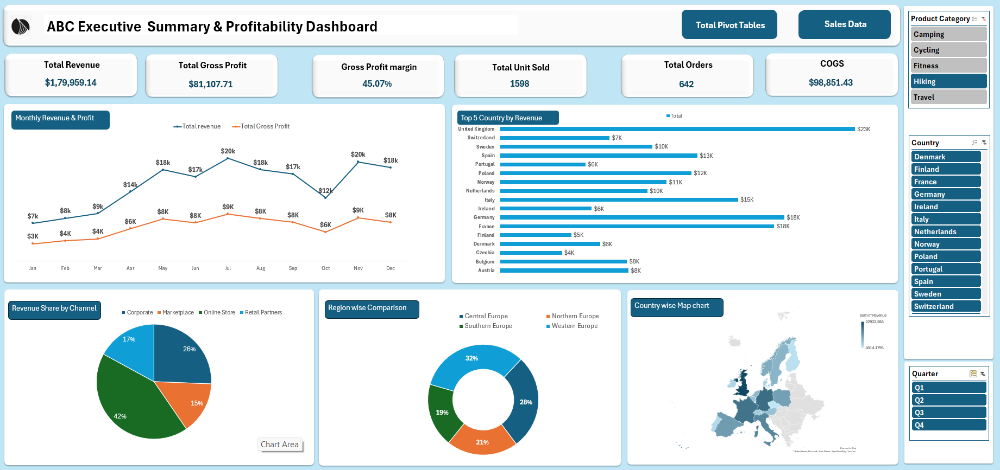

# Excel Sales Dashboard

## 📊 Description
An interactive Excel Sales Dashboard created to analyze sales performance, revenue, and profitability. It provides visual insights into monthly revenue and profit trends, top-performing countries, sales channel distribution, and regional performance.

## ✨ Features
- Monthly Revenue and Profit Analysis
- Top 5 Countries by Revenue
- Revenue Share by Sales Channel
- Region-wise Sales Comparison
- Geographical Sales Map
- Interactive Slicers for Product Category, Country, and Quarter
- Dynamic KPI Cards

## 🛠️ Tools Used
- Microsoft Excel
- Pivot Tables
- Pivot Charts
- Slicers
- Data Visualization

## 📷 Dashboard Preview

